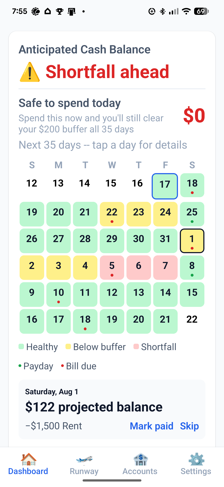
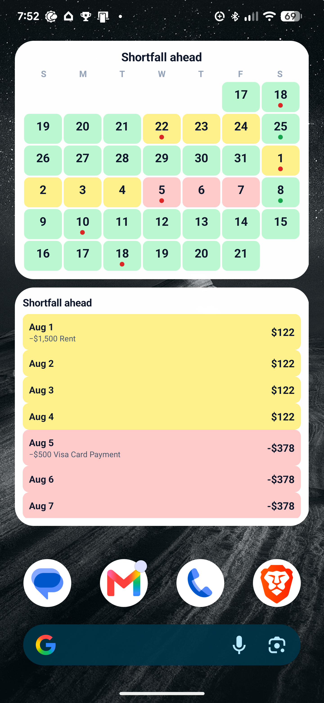
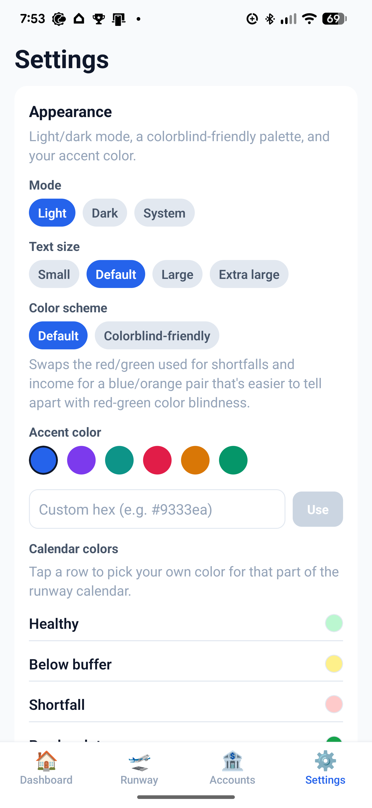

## Know your cash flow before it becomes a problem.

Runway answers one question:

> "What does my checking account look like over the next five weeks?"

Every paycheck, bill, and credit card payment is projected onto a calendar -- so surprises stop being surprises.

## Built differently

Runway is a cash-flow forecasting app, not a budgeting app.

No transactions to categorize.
No spending goals to maintain.
No analyzing your credit card statement.

Runway is also privacy-first.

No account required.
No cloud sync.
No collecting your personal information.

Your financial data stays in your hands.

## Features

- See your next 35 days on a calendar
- Know what is safe to spend today
- Predict upcoming credit card payments
- Forecast bills, transfers, and paychecks
- Set account safety buffers
- Home-screen widgets for at-a-glance cash flow
- Export your data whenever you want

  
  

## Get Runway

[Available on Google Play](https://play.google.com/store/apps/details?id=com.bob.cashflow)

## Learn more

- [Privacy Policy](privacy-policy.md)
- [Request a Feature](request-a-feature.md)
- [Get Help](get-help.md)
- [Support Runway](support-runway.md)
